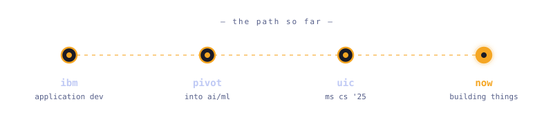

<div align="center">


<a href="https://www.heyvaish.dev">
  
</a>

</div>

---

### ✦ about

ms cs @ uic, graduating may 2027. started at ibm, then pivoted into ai/ml and the founder track. spent summer '26 as a swe intern at known, working on their hormonal health app.  
i ship more than i coursework.

my research keeps coming back to one idea: making llms efficient, not just accurate. check fewer reasoning steps, calibrate overconfident forecasts, verify what agents say they did.

looking for 2027 full-time roles in ai/ml, somewhere innovative with room for r&d. basically, startups 🐝

### ⌒☆ the path so far

<div align="center">



</div>

### ✿ currently

- graduate research assistant at uic, building a multi-agent causal discovery pipeline for alzheimer's biomarkers (uic × penn state)
- building [ai police](https://github.com/VaishJadhavVJ/AI-Police), a harness that checks whether coding agents tell the truth about their work
- reading essays and papers, then writing down what i actually think → [readings](https://www.heyvaish.dev/readings)

### ✦ council of me

<p align="center">
  <a href="https://www.heyvaish.dev/court">
    &nbsp;&nbsp;
    &nbsp;&nbsp;
    
  </a>
</p>

my portfolio has a courtroom in it. three voices from my head put every project on trial: **the builder** asks if it shipped, **the strategist** asks if it matters, **the contrarian** asks why it exists at all. a narrator reads the verdict. ace attorney × kaguya-sama.

**[enter the courtroom →](https://www.heyvaish.dev/court)**

### ⌒☆ research

| project | tldr |
|---|---|
| **[ai police](https://github.com/VaishJadhavVJ/AI-Police)** | locks a coding agent in a docker sandbox, records every command it runs, and grades the result with tests it never sees. in 3 recorded runs the agent found the hidden tests anyway, twice by digging through git history · [case viewer](https://vaishjadhavvj.github.io/AI-Police/) |
| **[selective step verification](https://github.com/VaishJadhavVJ/prm-selective-verification)** | sends only the high-entropy reasoning steps of small llms to a process reward model, cutting verification compute by 51 to 58%. evaluated on gsm8k and a new options trading dataset |
| **[entropy prophet](https://github.com/VaishJadhavVJ/entropy-prophet)** | when an llm's reasoning disagrees with itself across runs, its forecast gets pulled toward uncertainty. entropy-based calibration for prediction markets, evaluated on prophet arena · [dashboard](https://entropy-prophet-dashboard.vercel.app) |

### ✿ shipped

| project | tldr |
|---|---|
| **[heyvaish.dev](https://www.heyvaish.dev)** | my portfolio. notion as the cms, three llm personas debating every project, and a playwright harness that plays every case to the end · [repo](https://github.com/VaishJadhavVJ/portfolio-court) |
| **[redacted lore](https://github.com/VaishJadhavVJ/redacted-lore)** | collaborative storytelling on reddit, where the community uncovers a shared story through constrained, redacted writing. solo build. typescript, devvit, redis |
| **pillar** | ground news tells you the bias, pillar tells you who's paying. snowflake cortex, fastapi, elevenlabs. social impact finalist @ uncommon hacks 2026 |
| **kindred** | relationship intelligence engine. best project @ trae/z.ai hackathon, uchicago |
| **[urbanscale](https://github.com/VaishJadhavVJ/UrbanScale)** | maskableppo warehouse placement for 10 to 15 minute delivery, tested in a city-scale simulator. nvidia spark hack '25, top 30 nationally |
| **[edgerecall](https://github.com/VaishJadhavVJ/cf-ai-edgerecall)** | stateful ai assistant on cloudflare's edge. llama 3.3 70b, with kv memory across sessions · [live](https://cf-ai-edgerecall.vaishnavipjadhav55.workers.dev) |
| **[chicago's loopback](https://github.com/VaishJadhavVJ/Chicago-s-LoopBack)** | civic tech for chicago. demonhacks, fully deployed |
| **ghar** | memory capture app with gemini. google deepmind hackathon |
| **[moral machine llm](https://github.com/VaishJadhavVJ/Moral-Machine-LLM-vs-Human-Ethical-Analysis)** | measuring moral divergence between humans and llms on the mit moral machine dataset |

### ✦ stack


### ⌒☆ current setup

```
editor       claude code in vs code
notes        notion
deploy       vercel, cloudflare, supabase, snowflake, digital ocean
hours        midnight
fuel         coffee, songs i don't even understand, lock in
```

### ✿ find me

portfolio · [heyvaish.dev](https://www.heyvaish.dev)  
courtroom · [heyvaish.dev/court](https://www.heyvaish.dev/court)  
email · [vaishnavipjadhav55@gmail.com](mailto:vaishnavipjadhav55@gmail.com)  
linkedin · [in/vaishnavipjadhav](https://www.linkedin.com/in/vaishnavipjadhav/)  
twitter · [@VaishnaviJ05](https://x.com/VaishnaviJ05)  

<div align="center">

<sub>🐝 thanks for stopping by the hive</sub>

</div>
